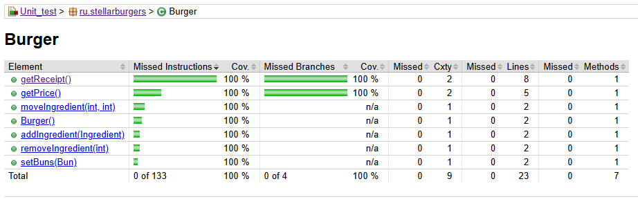

# Stellar Burgers — юнит-тестирование

Юнит-тесты сервиса заказа бургеров.
Покрывается класс `Burger` с использованием моков, стабов, верификации вызовов и параметризации.

## Технологии

## Структура проекта

    src
    ├── main
    │   └── java/ru/stellarburgers        — код программы: Bun, Burger, Ingredient, IngredientType, Database
    └── test
        └── java/ru/stellarburgers
            ├── dto                       — тестовые данные: BunData, IngredientData
            ├── BurgerParameterizedTest   — цена и чек: 5 параметризованных наборов
            ├── BurgerChangeIngredientsTest — removeIngredient, moveIngredient
            ├── BurgerCallMultiplicityTest  — verify: количество вызовов зависимостей
            └── ReceiptData               — эталонные чеки для сравнения

Отчёты о прогоне: `docs/jacoco` (покрытие) и `docs/surefire` (статус тестов).

## Как запустить

1. Клонировать репозиторий:

        git clone https://github.com/Rom-G/StellarBurgers_unit_testing.git

2. Запустить тесты:

        mvn clean test

3. Собрать отчёты:

        mvn verify

4. Посмотреть результаты:
    - **JaCoCo** (покрытие): `docs/jacoco/index.html` — актуальный отчёт лежит в репозитории;
    - **Surefire** (статус тестов): `docs/surefire/index.html`.

## Что покрыто

Сценарии, обоснование техник и граничные случаи — в [TEST_PLAN.md](TEST_PLAN.md).

| Тестовый класс | Методы Burger | Приёмы |
|---|---|---|
| BurgerParameterizedTest | getPrice, getReceipt | параметризация, моки, стабы |
| BurgerChangeIngredientsTest | removeIngredient, moveIngredient | моки, Assume для граничного случая |
| BurgerCallMultiplicityTest | getPrice, getReceipt | verify, spy |

## Покрытие

**100%** по классу Burger (JaCoCo): 133/133 instructions, 4/4 branches, 7/7 methods, 23/23 lines.

